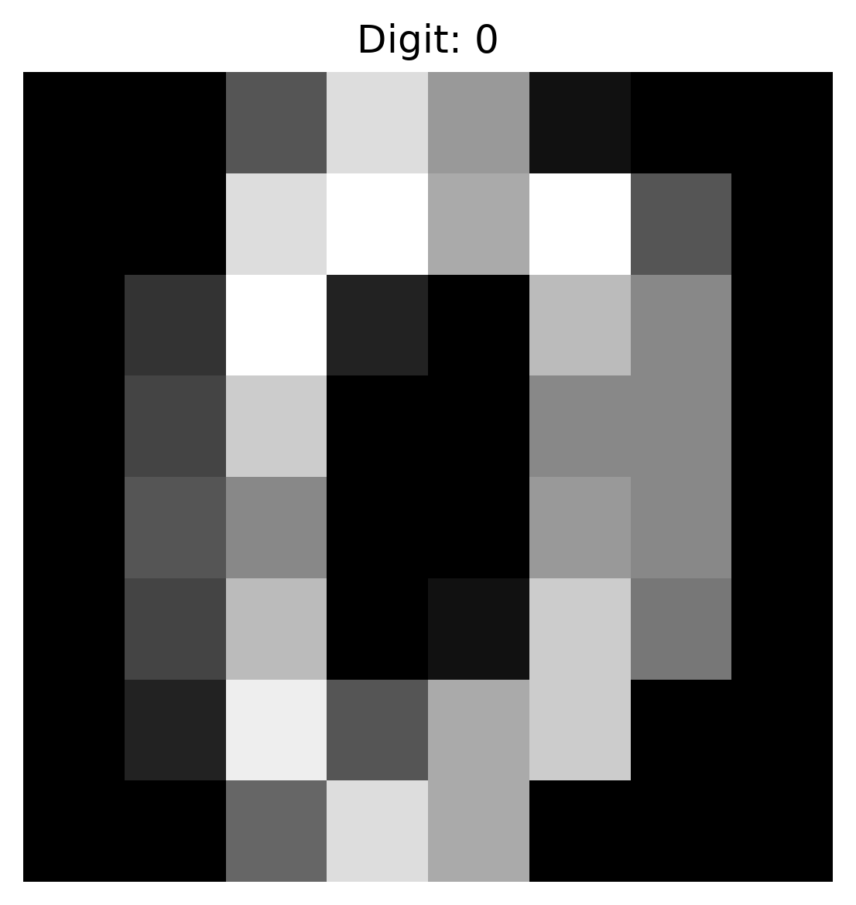
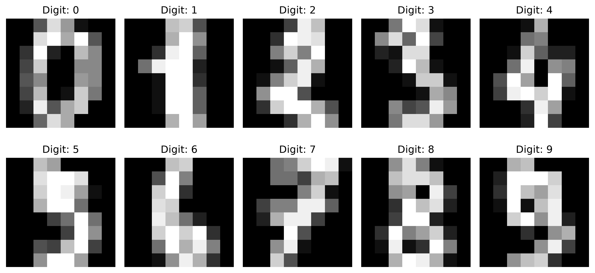
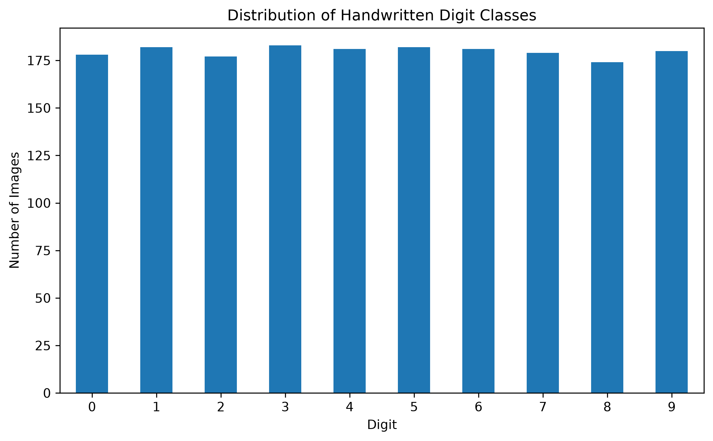
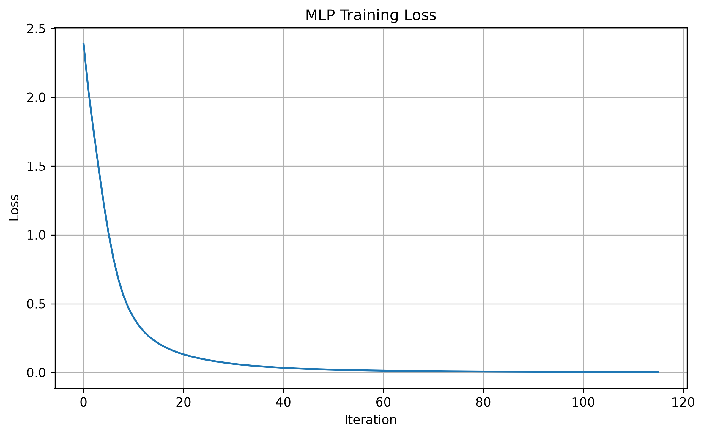
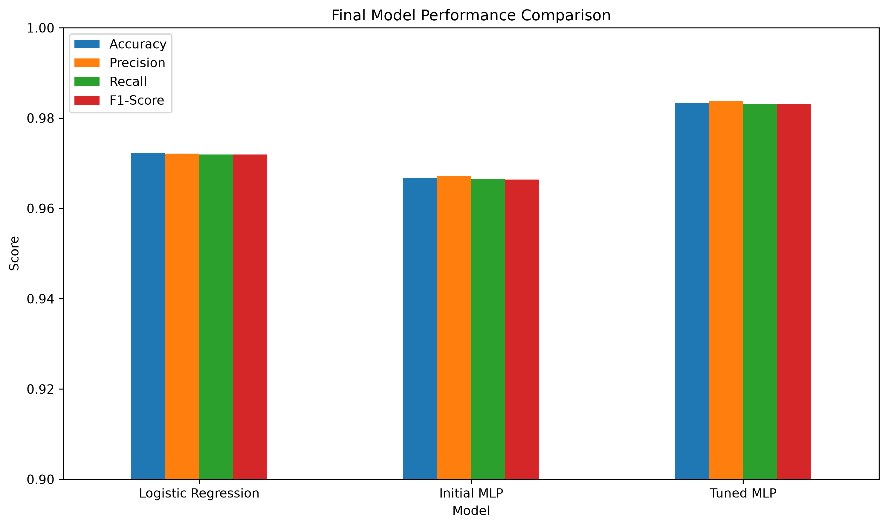
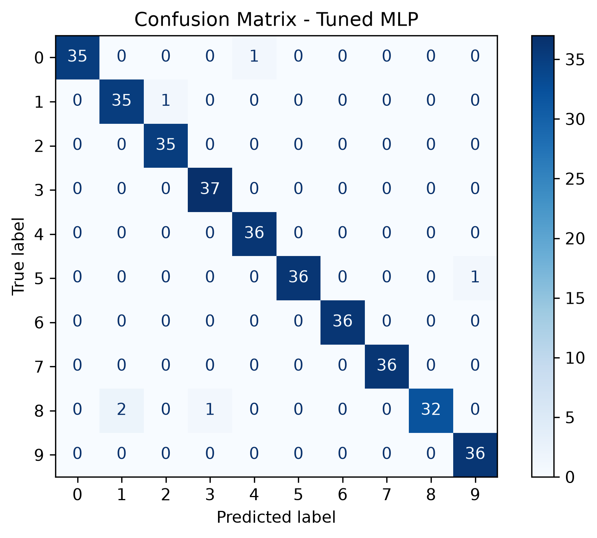
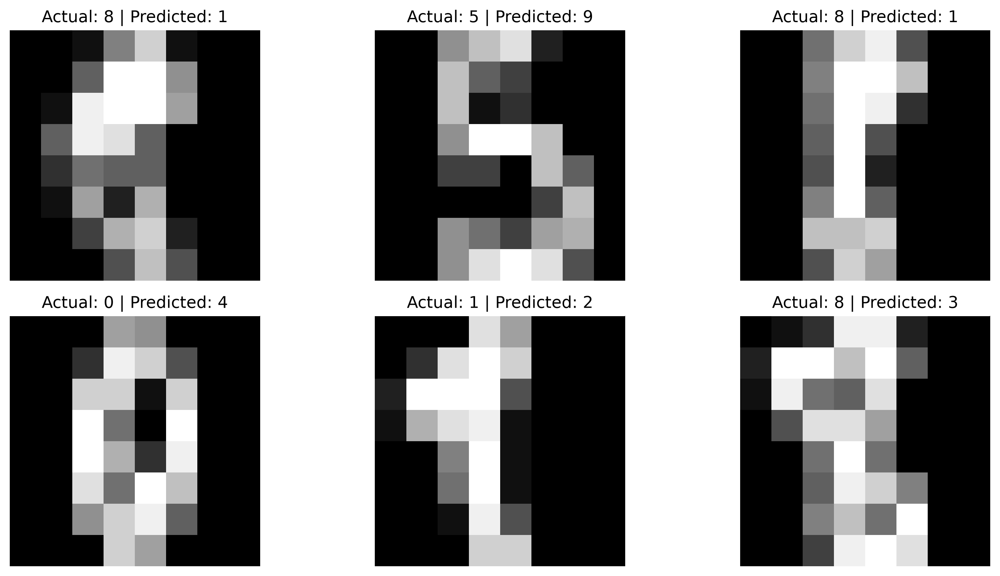
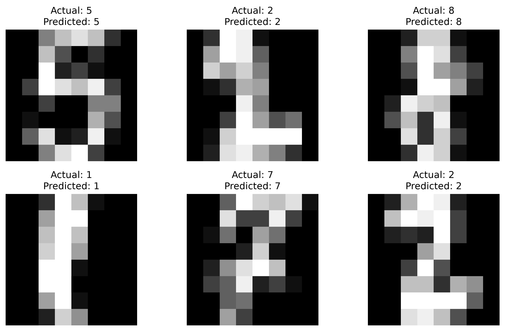

# Handwritten Digit Recognition

## Machine Learning Image Classification with Neural Networks

This project develops an end-to-end machine learning system for recognizing handwritten digits from grayscale images.

The project uses the **Digits dataset provided by scikit-learn**, where each handwritten digit is represented as an 8 × 8 grayscale image containing 64 pixel features.

Three model configurations are evaluated:

1. Logistic Regression as a baseline
2. An initial Multi-Layer Perceptron (MLP) neural network
3. A hyperparameter-tuned MLP neural network

After systematic hyperparameter tuning using 5-fold cross-validation, the final MLP achieved **98.33% accuracy** on the unseen test dataset.

---

## Project Overview

Handwritten digit recognition is a classic multi-class image classification problem.

The objective of this project is to build a model that can correctly identify handwritten digits from **0 through 9** based only on their pixel values.

Rather than immediately using a complex neural network, this project follows a structured machine learning workflow:

```text
Dataset
   ↓
Exploratory Data Analysis
   ↓
Data Visualization
   ↓
Train/Test Split
   ↓
Feature Standardization
   ↓
Logistic Regression Baseline
   ↓
Initial Neural Network
   ↓
Cross-Validation
   ↓
Hyperparameter Tuning
   ↓
Final Model Selection
   ↓
Confusion Matrix
   ↓
Error Analysis
```

This approach allows the performance of the neural network to be compared against a strong traditional machine learning baseline.

---

## Objectives

The main objectives of this project are to:

* Explore the handwritten digit dataset
* Understand the structure of image-based numerical data
* Visualize handwritten digit samples
* Analyze the distribution of digit classes
* Prepare the data for machine learning
* Build a Logistic Regression baseline
* Build a Multi-Layer Perceptron neural network
* Compare traditional machine learning with neural networks
* Apply feature standardization
* Perform 5-fold cross-validation
* Tune neural network hyperparameters using GridSearchCV
* Evaluate the final model using multiple metrics
* Analyze model errors using a confusion matrix
* Visualize incorrectly classified images
* Demonstrate predictions on unseen images

---

# Dataset

The project uses the built-in `load_digits()` dataset from **scikit-learn**.

The dataset contains grayscale images of handwritten digits ranging from 0 to 9.

### Dataset Characteristics

| Property           | Value |
| ------------------ | ----: |
| Total samples      | 1,797 |
| Image dimensions   | 8 × 8 |
| Features per image |    64 |
| Number of classes  |    10 |
| Classes            |   0–9 |
| Pixel value range  |  0–16 |

Each image contains 64 numerical pixel values.

The original image representation has the shape:

```text
8 × 8
```

For machine learning models, each image is flattened into:

```text
64 features
```

For example:

```text
8 × 8 image
     ↓
64 numerical features
     ↓
Machine learning model
     ↓
Predicted digit
```

The dataset is included directly in scikit-learn, so no external dataset download is required.

---

# Exploratory Data Analysis

Before training the models, the dataset was explored to understand its structure and distribution.

## Dataset Dimensions

The dataset contains:

```text
X shape: (1797, 64)
y shape: (1797,)
```

This means there are:

* 1,797 digit images
* 64 pixel features per image
* 1 target label for each image

---

## Image Representation

The dataset provides both flattened pixel data and the original image representation.

```text
Flattened sample shape: (64,)
Original image shape: (8, 8)
```

The flattened representation is used for machine learning, while the original 8 × 8 representation is used for visualization.

---

## Sample Digit



---

## Sample Digit Collection



The visualization demonstrates how different handwritten versions of the digits appear in the dataset.

---

# Class Distribution

The distribution of the ten digit classes was analyzed before training the models.



The dataset is relatively well balanced across the ten classes, which is useful for multi-class classification.

Because there is no severe class imbalance, accuracy and macro-averaged precision, recall, and F1-score provide useful overall performance measures.

---

# Data Preparation

## Train/Test Split

The dataset was divided into training and testing sets using an 80/20 split.

A stratified split was used to preserve the class distribution across both datasets.

```text
Training samples: 1,437
Testing samples:    360
```

The test set was kept separate throughout model development and hyperparameter tuning.

This prevents information from the test dataset from influencing model selection.

---

## Feature Scaling

The pixel values range from 0 to 16.

Feature standardization was applied using `StandardScaler`.

The preprocessing and model were combined using a scikit-learn `Pipeline`.

This is important because the scaler is fitted only on the training data during model fitting and cross-validation.

The workflow is:

```text
Training Data
     ↓
StandardScaler
     ↓
Machine Learning Model
```

Using a pipeline helps prevent data leakage during cross-validation.

---

# Model Development

Three model configurations were evaluated.

## 1. Logistic Regression

Logistic Regression was selected as the baseline model.

Although handwritten digits are image data, the relatively small 8 × 8 images can still be classified effectively using a traditional linear classification model.

The baseline model achieved:

```text
Accuracy: 97.22%
```

This established a strong benchmark for the neural network.

---

## 2. Initial MLP Neural Network

A Multi-Layer Perceptron neural network was then developed using scikit-learn's `MLPClassifier`.

The initial architecture was:

```text
64 input features
       ↓
64 hidden neurons
       ↓
32 hidden neurons
       ↓
10 output classes
```

The network used:

* ReLU activation
* Adam optimizer
* Standardized input features
* 300 maximum iterations

The initial MLP achieved:

```text
Accuracy: 96.67%
```

Interestingly, the initial neural network performed slightly worse than the Logistic Regression baseline.

This demonstrates an important machine learning principle:

> A more complex model does not automatically produce better results.

Model architecture and hyperparameters need to be chosen appropriately for the dataset.

---

# Neural Network Training

The training loss of the initial MLP was monitored during training.



The training loss decreased substantially during optimization, showing that the neural network successfully learned patterns from the training data.

However, training performance alone is not enough to determine whether a model generalizes well to unseen data.

Therefore, validation and test performance were also considered.

---

# Cross-Validation

5-fold cross-validation was used to evaluate the baseline Logistic Regression model and later to tune the MLP.

Cross-validation divides the training dataset into five subsets.

The model is trained five times, with a different subset used for validation each time.

```text
Fold 1 → Train → Validate
Fold 2 → Train → Validate
Fold 3 → Train → Validate
Fold 4 → Train → Validate
Fold 5 → Train → Validate
```

This provides a more reliable estimate of model performance than relying on a single training/validation split.

The Logistic Regression model achieved approximately:

```text
CV Accuracy: 97.01% ± 0.84%
```

---

# Hyperparameter Tuning

Because the initial MLP did not outperform the Logistic Regression baseline, systematic hyperparameter tuning was performed.

`GridSearchCV` was used with 5-fold cross-validation.

The search evaluated different combinations of:

* Hidden layer architecture
* L2 regularization strength (`alpha`)
* Learning rate initialization

The parameter search included:

```text
Hidden layers:
(32,)
(64,)
(64, 32)
(128, 64)

Alpha:
0.0001
0.001
0.01

Learning rate:
0.001
0.01
```

This resulted in:

```text
24 parameter combinations
×
5 cross-validation folds
=
120 model fits
```

---

# Best Neural Network Configuration

The best configuration found by GridSearchCV was:

```text
Hidden Layer Size: (64,)
Alpha:             0.001
Learning Rate:     0.01
Activation:        ReLU
Solver:            Adam
```

The optimized architecture is:

```text
64 input features
       ↓
64 hidden neurons
       ↓
10 output classes
```

The best cross-validation accuracy was:

```text
97.91%
```

This was a significant improvement over the initial MLP configuration.

---

# Model Comparison

The three evaluated model configurations were compared using accuracy, precision, recall, and F1-score.

| Model               |   Accuracy |  Precision |     Recall |   F1-Score |
| ------------------- | ---------: | ---------: | ---------: | ---------: |
| Logistic Regression |     97.22% |     97.21% |     97.19% |     97.19% |
| Initial MLP         |     96.67% |     96.71% |     96.65% |     96.64% |
| **Tuned MLP**       | **98.33%** | **98.38%** | **98.32%** | **98.32%** |

---

## Performance Comparison



The tuned MLP achieved the highest performance across all four evaluation metrics.

Compared with the Logistic Regression baseline, the tuned MLP improved test accuracy from:

```text
97.22%
```

to:

```text
98.33%
```

This represents an improvement of approximately **1.11 percentage points**.

---

# Final Model Evaluation

The tuned MLP was selected as the final model because it achieved the strongest performance on the unseen test dataset.

### Final Test Results

| Metric    |      Score |
| --------- | ---------: |
| Accuracy  | **98.33%** |
| Precision | **98.38%** |
| Recall    | **98.32%** |
| F1-Score  | **98.32%** |

The test dataset contained 360 images.

The final model correctly classified:

```text
354 / 360 images
```

and incorrectly classified:

```text
6 / 360 images
```

The resulting misclassification rate was:

```text
1.67%
```

---

# Classification Report

The classification report provides performance for each individual digit.

| Digit | Precision | Recall | F1-Score |
| ----: | --------: | -----: | -------: |
|     0 |      1.00 |   0.97 |     0.99 |
|     1 |      0.95 |   0.97 |     0.96 |
|     2 |      0.97 |   1.00 |     0.99 |
|     3 |      0.97 |   1.00 |     0.99 |
|     4 |      0.97 |   1.00 |     0.99 |
|     5 |      1.00 |   0.97 |     0.99 |
|     6 |      1.00 |   1.00 |     1.00 |
|     7 |      1.00 |   1.00 |     1.00 |
|     8 |      1.00 |   0.91 |     0.96 |
|     9 |      0.97 |   1.00 |     0.99 |

The model performed particularly well across most digit classes.

Digit **8** was the most difficult class, with a recall of **91%**.

---

# Confusion Matrix

A confusion matrix was used to examine how the model classified each individual digit.



The diagonal represents correctly classified images, while off-diagonal values represent classification errors.

The matrix shows that the majority of predictions are concentrated along the diagonal, confirming the strong overall performance of the final model.

---

# Misclassification Analysis

Even though the model achieved 98.33% accuracy, it still made six incorrect predictions.

The misclassified images were extracted from the test dataset and visualized to understand the model's errors.



These errors demonstrate that some handwritten digits can contain visual patterns that make them difficult to distinguish.

In particular, digit **8** produced the lowest recall among the ten classes.

Error analysis is important because model evaluation should not stop at a single accuracy value.

---

# Individual Predictions

The final model was also tested on individual unseen images from the test dataset.



Each example compares:

```text
Actual digit
      vs.
Predicted digit
```

This provides a simple visual demonstration of how the trained model performs on individual handwritten digit images.

---

# Key Findings

### 1. Logistic Regression is already a strong baseline

The Logistic Regression model achieved **97.22% accuracy**, demonstrating that even a relatively simple model can perform extremely well on this small image dataset.

### 2. The initial neural network was not automatically better

The initial MLP achieved **96.67% accuracy**, which was lower than Logistic Regression.

This shows that neural networks do not automatically outperform traditional models.

### 3. Hyperparameter tuning made a major difference

After tuning the MLP's architecture, regularization, and learning rate, the model achieved **98.33% test accuracy**.

### 4. Cross-validation supported the model choice

The tuned MLP achieved **97.91% cross-validation accuracy**, providing evidence that the strong test performance was not simply the result of a lucky split.

### 5. Error analysis revealed the difficult class

Digit **8** was the most challenging class, with a recall of **91%**.

### 6. The final model generalized well

Only 6 of 360 unseen test images were misclassified.

---

# Technologies Used

* Python
* NumPy
* Pandas
* Matplotlib
* Scikit-learn
* Jupyter Notebook

---

# Machine Learning Techniques Demonstrated

This project demonstrates practical use of:

* Multi-class classification
* Exploratory data analysis
* Image visualization
* Train/test splitting
* Stratified sampling
* Feature standardization
* Scikit-learn Pipelines
* Logistic Regression
* Neural Networks
* MLPClassifier
* ReLU activation
* Adam optimization
* Cross-validation
* GridSearchCV
* Hyperparameter tuning
* Accuracy evaluation
* Precision evaluation
* Recall evaluation
* F1-score evaluation
* Classification reports
* Confusion matrices
* Error analysis
* Model comparison
* Final model selection

---

# Project Structure

```text
handwritten-digit-recognition/
│
├── data/
│
├── images/
│   ├── sample_digit.png
│   ├── sample_digits.png
│   ├── digit_distribution.png
│   ├── mlp_training_loss.png
│   ├── model_comparison.png
│   ├── final_model_comparison.png
│   ├── confusion_matrix.png
│   ├── misclassified_digits.png
│   ├── prediction_examples.png
│   └── final_model_results.csv
│
├── handwritten_digit_recognition.ipynb
├── README.md
├── requirements.txt
└── .gitignore
```

The `data/` directory is retained for consistency with the portfolio project structure, although the dataset itself does not need to be stored there because it is loaded directly from scikit-learn.

---

# Installation

Clone the repository:

```bash
git clone https://github.com/Rajesh-code11/handwritten-digit-recognition.git
```

Navigate into the project directory:

```bash
cd handwritten-digit-recognition
```

Install the required dependencies:

```bash
pip install -r requirements.txt
```

Launch Jupyter Notebook:

```bash
jupyter notebook
```

Open:

```text
handwritten_digit_recognition.ipynb
```

Then run the notebook from top to bottom.

---

# Requirements

The main Python libraries used in this project are:

```text
numpy
pandas
matplotlib
scikit-learn
jupyter
```

---

# Future Improvements

Although the current model achieves excellent performance, the project could be extended in several ways.

Possible improvements include:

* Testing additional neural network architectures
* Exploring different regularization strategies
* Evaluating alternative classifiers
* Using image augmentation techniques
* Comparing scikit-learn MLP with a convolutional neural network
* Using a larger and more realistic handwritten digit dataset
* Deploying the trained model as a web application
* Creating an interactive interface where users can draw a digit and receive a prediction

A future version could therefore move from a traditional machine learning approach toward a deep learning image classification system.

---

# Conclusion

This project demonstrates a complete machine learning workflow for handwritten digit recognition.

A Logistic Regression baseline achieved **97.22% accuracy**, while the initial MLP achieved **96.67% accuracy**.

Rather than assuming that the neural network would automatically perform better, hyperparameter tuning was performed using `GridSearchCV` and 5-fold cross-validation.

The optimized MLP achieved:

* **97.91% cross-validation accuracy**
* **98.33% test accuracy**
* **98.38% precision**
* **98.32% recall**
* **98.32% F1-score**

The final model correctly classified **354 out of 360 unseen test images**.

The project demonstrates not only how to train a neural network, but also how to establish a baseline, validate models, tune hyperparameters, compare competing approaches, investigate errors, and select a final model based on evidence.

---

# Author

**Rajesh**

Computer Science and Technology Student

GitHub: **Rajesh-code11**
